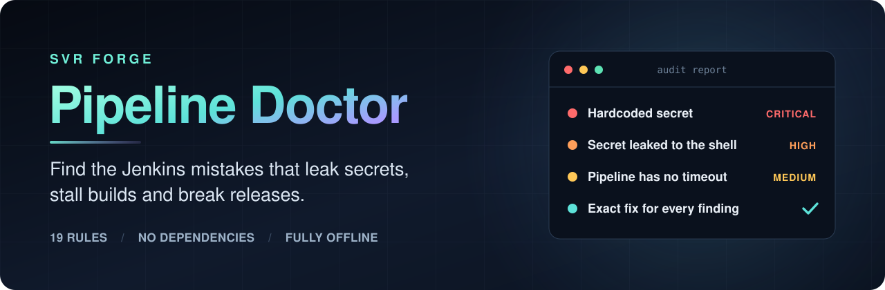
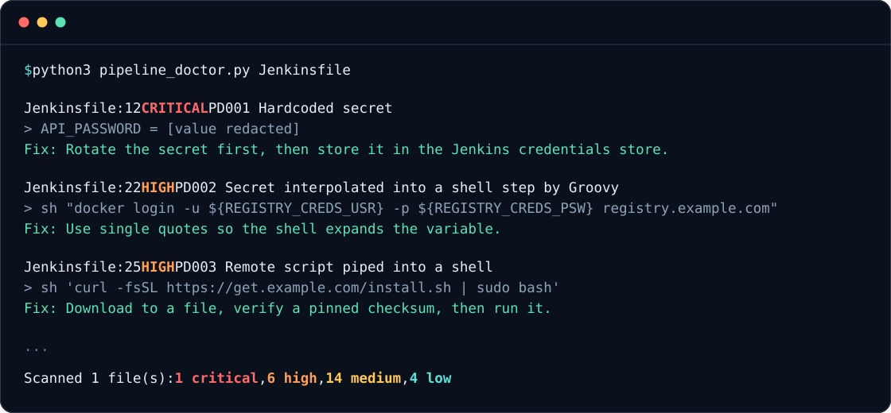

<div align="center">



<br />

[](https://github.com/svrforge/devops-forge/actions/workflows/ci.yml)
[](LICENSE)


**Audit every Jenkins pipeline in seconds. No Jenkins server, no install and nothing leaves your machine.**

[Quick start](#quick-start) &nbsp;·&nbsp; [What it finds](#what-it-finds) &nbsp;·&nbsp; [Use it in CI](#use-it-in-ci) &nbsp;·&nbsp; [Agent skill](#use-it-as-an-agent-skill) &nbsp;·&nbsp; [Professional audit](#professional-audit)

</div>

<br />



<sub>Shortened output from a deliberately insecure test pipeline. Read the [full sample report](plugins/pipeline-doctor/examples/sample-report.md).</sub>

## Why Pipeline Doctor

Jenkins will happily run a pipeline that leaks a password, hangs forever or deploys out of order. Syntax checkers confirm that a Jenkinsfile is valid. Pipeline Doctor checks whether it is safe.

<table>
<tr>
<td width="50%" valign="top">

**Security first**

Finds hardcoded secrets, credentials leaked through Groovy interpolation, shell injection, privileged containers and builds on the controller.

</td>
<td width="50%" valign="top">

**A fix for every finding**

Each result gives the file, the line, why it matters and what to change, so a report turns straight into work.

</td>
</tr>
<tr>
<td width="50%" valign="top">

**Private by design**

It reads files and nothing else. It makes no network calls, never runs your code and redacts secrets from every report.

</td>
<td width="50%" valign="top">

**Runs anywhere**

One Python file with no dependencies. It works on Linux, macOS and Windows, on a laptop or in any CI system.

</td>
</tr>
</table>

## Quick start

```bash
curl -fsSLO https://raw.githubusercontent.com/svrforge/devops-forge/main/plugins/pipeline-doctor/skills/audit/scripts/pipeline_doctor.py
python3 pipeline_doctor.py /path/to/your/repo
```

On Windows, use `curl.exe` and `python`. It finds Jenkinsfiles and shared-library Groovy automatically.

```bash
python3 pipeline_doctor.py . --format markdown --output report.md    # A report to share
python3 pipeline_doctor.py . --format sarif --output results.sarif   # GitHub code scanning
python3 pipeline_doctor.py . --format json                           # Your own tooling
```

## What it finds

| Severity | Rule | Finding |
| :--- | :--- | :--- |
| Critical | PD001 | Hardcoded secret |
| High | PD002 | Secret interpolated into a shell step by Groovy |
| High | PD003 | Remote script piped into a shell |
| High | PD004 | Privileged container or Docker socket mount |
| High | PD005 | Build runs on the Jenkins controller |
| Medium | PD006 | Untrusted value interpolated into a shell step |
| Medium | PD007 | TLS or host-key verification disabled |
| Medium | PD008 | Shared library not pinned to a release |
| Medium | PD009 | Container image not pinned |
| Medium | PD010 | Jenkins internal API used from a pipeline |
| Medium | PD011 | Pipeline has no timeout |
| Medium | PD012 | Pipeline step called inside `@NonCPS` |
| Medium | PD013 | `input` step holds an executor |
| Medium | PD014 | Deployment can run concurrently |
| Medium | PD015 | Test or scan failure is hidden |
| Low | PD016 | No build retention policy |
| Low | PD017 | `agent any` |
| Low | PD018 | Cron trigger without `H` |
| Low | PD019 | World-writable permissions |

[Read why each rule matters and how to fix it.](plugins/pipeline-doctor/skills/audit/references/rules.md)

## Use it in CI

The exit code is 1 when a finding is at or above `--fail-on`, so one command can stop an unsafe pipeline from merging.

**GitHub Actions**

```yaml
- name: Audit Jenkins pipelines
  run: |
    curl -fsSLO https://raw.githubusercontent.com/svrforge/devops-forge/main/plugins/pipeline-doctor/skills/audit/scripts/pipeline_doctor.py
    python3 pipeline_doctor.py . --fail-on high
```

**Jenkins**

```groovy
stage('Audit pipelines') {
    steps {
        sh 'python3 pipeline_doctor.py . --fail-on high'
    }
}
```

For production CI, keep a reviewed copy of the script in your repository or pin the URL to a commit.

To accept a finding on purpose, add a comment on the same line or the line above:

```groovy
// pipeline-doctor:ignore PD009
```

## Use it as an agent skill

Pipeline Doctor installs as a skill, so your coding agent can run the audit, confirm the findings and propose exact fixes.

**Claude Code**

```bash
claude plugin marketplace add svrforge/devops-forge
claude plugin install pipeline-doctor@devops-forge
```

**Codex**

```bash
codex plugin marketplace add svrforge/devops-forge
codex plugin add pipeline-doctor@devops-forge
```

Then ask: *"Audit the Jenkins pipelines in this repository."*

## Built to be trusted

- **Tested on real pipelines.** Rules were tuned against 673 public Jenkinsfiles and shared-library files.
- **Tested in CI.** A unit test suite runs on Linux, macOS and Windows, and this repository's own [Jenkinsfile](Jenkinsfile) must pass its own audit.
- **Honest about limits.** It is a fast static check for these 19 patterns. It cannot see job, folder or controller settings, so a clean report does not prove that a pipeline is secure.

## Professional audit

Need a deeper review? I offer a fixed-scope Jenkins audit for teams:

- Manual review of your pipelines and shared libraries, beyond what a scanner can see
- A prioritised report written for both engineers and managers
- Exact fixes, delivered as pull requests

**[Request an audit](https://github.com/svrforge/devops-forge/issues/new?template=audit-request.yml)**

## About

Built by [Vignesh Raja Sundararajan](https://github.com/svrforge), a DevOps and platform engineer, at SVR Forge.

Released under the [MIT License](LICENSE). Free to use, including at work.
